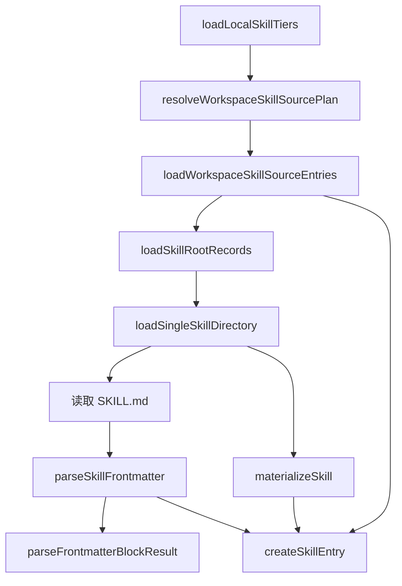
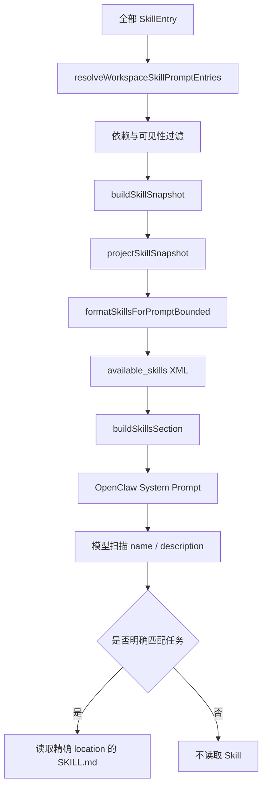
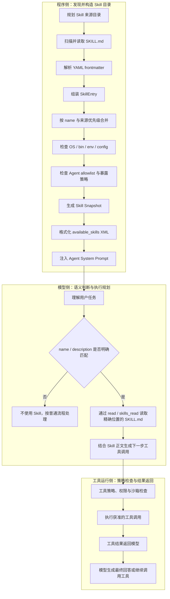

# OpenClaw Skill 生命周期源码地图

## 1. 阅读范围与版本

- OpenClaw 源码仓库：<https://github.com/openclaw/openclaw>
- 阅读版本（commit）：`4217e957da91629c74db29b4a96d7692d10b3d55`
- 阅读重点：`SKILL.md` frontmatter、Skill 来源与优先级、意图分发、加载到执行的生命周期
- 暂不包含：逐行实现分析、HarmonyOS 适配方案、具体 Skill 移植

## 2. 核心模块地图

### 2.1 四个基础问题

1. **Skill 是什么？**  每个 Skill 是一个目录，核心文件为 `SKILL.md`；文件由 YAML frontmatter 和 Markdown 指令正文组成，用来告诉 Agent 何时以及如何使用工具。
2. **OpenClaw 从哪里寻找 Skill？**  系统会从 workspace、project agent、personal、managed、workshop、bundled/custodian 以及 extra/plugin 等来源发现 Skill。
3. **什么决定 Skill 是否可用？**  系统会综合检查同名 Skill 的来源优先级、运行环境要求、配置、外部二进制、Agent allowlist、调用策略和会话快照。
4. **可用 Skill 怎样交给模型？**  系统把可见 Skill 的 `name`、`description` 和 `location` 格式化为 `<available_skills>` XML 目录并注入系统提示词；模型根据任务匹配描述，再读取选中的 `SKILL.md`。

### 2.2 文档层模块图


这张图是依据官方文档整理的高层地图，后续章节用源码文件和函数调用关系验证各节点。

## 3. SKILL.md 与 YAML frontmatter 加载链

### 3.1 主调用链



### 3.2 各节点职责

- `resolveWorkspaceSkillSourcePlan()`：根据 workspace、配置、Agent 和运行环境生成需要扫描的 Skill 根目录计划。
- `loadWorkspaceSkillSourceEntries()`：逐个读取来源计划，并按照 tier 收集 Skill 记录。
- `loadSkillRootRecords()`：在单个根目录内发现包含 `SKILL.md` 的候选目录。
- `loadSingleSkillDirectory()`：读取一个 Skill 的 `SKILL.md`，解析 frontmatter，并验证 `name` 与 `description`。
- `parseSkillFrontmatter()`：调用通用 Markdown frontmatter 解析器；遇到解析问题时抛出错误。
- `materializeSkill()`：把正文、名称、描述、文件路径和来源整理为基础 Skill 对象。
- `createSkillEntry()`：解析 OpenClaw metadata 与调用策略，补充是否进入运行时注册表、模型提示词和用户命令入口等暴露信息。

### 3.3 数据流总结

这一阶段的核心数据变化可以概括为：

```text
Skill 根目录
→ SKILL.md 原始文本
→ ParsedSkillFrontmatter + Skill
→ SkillEntry（含 metadata、invocation、exposure）
```

## 4. Skill 来源与加载优先级

### 4.1 核心来源优先级

```text
workspace > project agent > personal > bundled
```

### 4.2 当前版本的完整优先级

以下顺序按优先级从高到低排列：

| 优先级 | 来源 | 默认路径或说明 |
| --- | --- | --- |
| 1 | Workspace skills | `<workspace>/skills` |
| 2 | Project agent skills | `<workspace>/.agents/skills` |
| 3 | Personal agent skills | `~/.agents/skills` |
| 4 | Managed / local skills | `<state-dir>/skills` |
| 5 | Workshop skills | `<state-dir>/agents/<agentId>/agent/workshop-skills` |
| 6 | Bundled / Custodian skills | 随 OpenClaw 安装发布 |
| 7 | Extra directories / plugin skills | `skills.load.extraDirs` 与插件目录 |

### 4.3 源码中的覆盖方式


`loadWorkspaceSkillSourceEntries()` 将来源按低到高组织为 `extra → bundled → workshop → managed → personal → workspace`。`resolveWorkspaceSkillDirectories()` 又在 workspace tier 内按 `project agent → workspace` 排列。`mergeSkillRecords()` 使用 Skill 的 `name` 作为键，遍历时以当前记录替换此前的同名记录，因此后加载的高优先级来源成为最终 winner。

如果 Agent workspace 与实际 execution workspace 不同，`appendLowerPrecedenceSkillRecords()` 会把 execution workspace 的技能作为更低优先级补充；同名时仍保留 Agent workspace 已选出的 winner。

> 核心来源链突出 workspace、project agent、personal 与 bundled 四层；当前源码还包含 managed、workshop、extra/plugin 等来源，因此本地图同时展示核心链和实际完整链。

## 5. Skill Router 与意图分发链

### 5.1 结论：没有单一的传统 SkillRouter

当前版本中没有发现一个统一的 `SkillRouter` 类负责把意图硬编码映射到 Skill。所谓“Skill Router”更适合描述为两段式机制：

1. **程序侧目录构建**：发现、合并并过滤 Skill，将可见 Skill 的名称、描述和读取位置放入系统提示词。
2. **模型侧语义选择**：模型阅读 `<available_skills>`，根据用户任务与 `name` / `description` 的匹配程度决定是否读取某个 `SKILL.md`。

### 5.2 自动选择链路



`formatSkillsForPromptCore()` 为每个可见 Skill 输出以下核心字段：

```xml
<skill>
  <name>...</name>
  <description>...</description>
  <location>...</location>
</skill>
```

`buildSkillsSection()` 再加入“扫描 `<available_skills>`、明确匹配时读取完整说明、不要自行猜测路径”等模型指令。只有 Agent 能访问 `read`、`skills_read` 或相应 CLI 文件工具时，这一 Skills 区段才会进入系统提示词。

### 5.3 显式调用旁路

用户也可以在消息中写 `$skill-name`。OpenClaw 会在当前 Agent 已授权、eligible 且 user-invocable 的 Skill 中解析该名称，并要求模型在行动前读取对应 `SKILL.md`。如果 Skill 声明 `command-dispatch: tool`，部分命令入口还可以绕过模型，直接分发到注册工具。

因此，意图分发不能只画成一个函数调用：自动调用的关键决策发生在模型侧，显式 `$skill-name` 和直接 tool dispatch 则是另外两条入口。

## 6. 从加载到执行的完整生命周期

### 6.1 端到端调用链



### 6.2 三条入口的关系

| 入口 | 选择发生在哪里 | 后续路径 |
| --- | --- | --- |
| 普通自然语言请求 | 模型根据 `<available_skills>` 的 `name` / `description` 做语义匹配 | 读取完整 `SKILL.md`，再按说明调用工具 |
| 显式 `$skill-name` | 程序先解析并验证指定 Skill，随后提示模型必须先读对应文件 | 读取完整 `SKILL.md`，再按说明调用工具 |
| `command-dispatch: tool` | 程序侧命令分发与工具策略 | 通过策略检查后直接调用注册工具，不经过模型选 Skill |

### 6.3 生命周期边界

- **Skill 被发现不等于可用**：来源扫描只能证明文件存在，仍需通过运行条件、Agent 可见性和调用策略检查。
- **Skill 可用不等于一定执行**：自动入口中，程序只把候选目录交给模型；是否匹配由模型结合用户意图决定。
- **读取 Skill 不等于绕过权限**：`SKILL.md` 是执行说明，不会跳过工具 allowlist、认证、沙箱或其他运行时限制。
- **会话使用快照**：模型看到的是构造系统提示词时生成的 Skill Snapshot，不应把磁盘上的全部 Skill 直接等同于本轮可选目录。

## 7. 关键文件与函数索引

| 阶段 | 文件 | 函数 | 一句话职责 |
| --- | --- | --- | --- |
| 来源规划 | `src/skills/loading/workspace-skill-sources.ts` | `resolveWorkspaceSkillSourcePlan` | 生成需要扫描的 Skill 来源计划 |
| 来源加载 | `src/skills/loading/skill-root-loader.ts` | `loadWorkspaceSkillSourceEntries` | 加载所有来源并按 tier 汇集记录 |
| 根目录扫描 | `src/skills/loading/skill-root-loader.ts` | `loadSkillRootRecords` | 找到根目录下的 Skill 候选项 |
| 单项加载 | `src/skills/loading/local-loader.ts` | `loadSingleSkillDirectory` | 读取和验证一个 `SKILL.md` |
| YAML 解析 | `src/skills/loading/frontmatter.ts` | `parseSkillFrontmatter` | 解析并返回 frontmatter |
| 条目组装 | `src/skills/loading/skill-entry-metadata.ts` | `createSkillEntry` | 形成带策略和可见性信息的 `SkillEntry` |
| 同名合并 | `src/skills/loading/skill-precedence.ts` | `mergeSkillRecords` | 以名称为键，让后加载的高优先级记录覆盖同名记录 |
| 环境检查 | `src/skills/loading/config.ts` | `prepareSkillBinaryProbe` / `shouldIncludeSkill` | 准备依赖探测并检查 OS、二进制、环境变量和配置条件 |
| 可见性过滤 | `src/skills/loading/workspace-skill-filter.ts` | `filterSkillEntries` | 结合 Agent 选择范围与 eligibility 筛选条目 |
| Prompt 筛选 | `src/skills/loading/workspace-skill-loader.ts` | `resolveWorkspaceSkillPromptEntries` | 选出允许进入提示词的 Skill 条目 |
| 快照构建 | `src/skills/loading/workspace-skill-prompt.ts` | `buildSkillSnapshot` | 把 eligible 条目投影为会话 Skill 快照 |
| 运行时准备 | `src/agents/embedded-agent-runner/skill-runtime.ts` | `prepareEmbeddedSkills` | 为一次 Agent 运行准备快照、提示词和环境覆盖 |
| 目录格式化 | `src/skills/loading/skill-contract.ts` | `formatSkillsForPromptCore` | 生成 `<available_skills>` XML 目录 |
| 系统提示词接入 | `src/agents/system-prompt-skills.ts` | `buildSkillsSection` | 生成模型可见的 Skills 指令区段 |
| 系统提示词组装 | `src/agents/system-prompt.ts` | `buildAgentSystemPrompt` | 将 Skills 区段与其他 Agent 指令合并 |
| 单次运行注入 | `src/agents/embedded-agent-runner/run/attempt-system-prompt-prepare.ts` | `prepareEmbeddedAttemptSystemPrompt` | 把本次运行的 Skills Prompt 交给系统提示词构建器 |
| 显式引用 | `src/skills/discovery/chat-command-invocation.ts` | `expandExplicitSkillReferences` | 展开并校验用户输入中的 `$skill-name` |
| 直接工具分发 | `src/skills/runtime/tool-dispatch.ts` | `resolveSkillDispatchTools` | 为声明直接分发的 Skill 解析允许调用的工具 |

## 8. 参考资料

- [OpenClaw Skills 官方文档（固定版本）](https://github.com/openclaw/openclaw/blob/4217e957da91629c74db29b4a96d7692d10b3d55/docs/tools/skills.md)
- [OpenClaw System Prompt 官方文档（固定版本）](https://github.com/openclaw/openclaw/blob/4217e957da91629c74db29b4a96d7692d10b3d55/docs/concepts/system-prompt.md)
- [Skill 来源与优先级实现](https://github.com/openclaw/openclaw/blob/4217e957da91629c74db29b4a96d7692d10b3d55/src/skills/loading/skill-root-loader.ts)
- [单个 SKILL.md 加载实现](https://github.com/openclaw/openclaw/blob/4217e957da91629c74db29b4a96d7692d10b3d55/src/skills/loading/local-loader.ts)
- [Skill 提示词目录格式化实现](https://github.com/openclaw/openclaw/blob/4217e957da91629c74db29b4a96d7692d10b3d55/src/skills/loading/skill-contract.ts)
- [显式 Skill 引用实现](https://github.com/openclaw/openclaw/blob/4217e957da91629c74db29b4a96d7692d10b3d55/src/skills/discovery/chat-command-invocation.ts)
