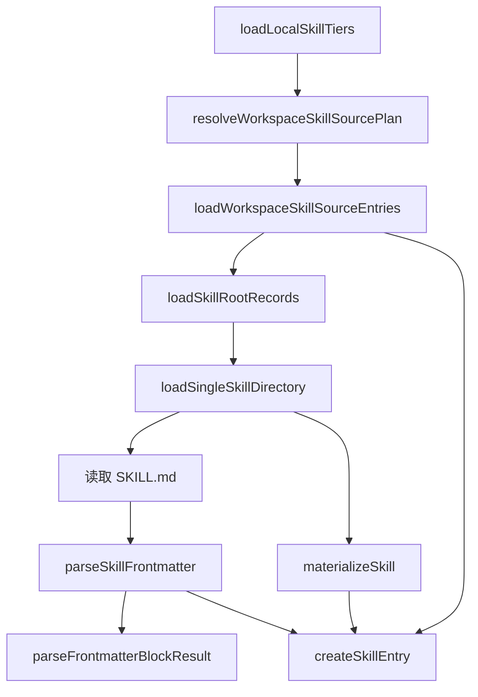

# OpenClaw Skill 生命周期源码地图

> 第一周产出：只梳理模块划分与关键调用链，不做逐行精读。

## 1. 阅读范围与版本

- OpenClaw 源码仓库：<https://github.com/openclaw/openclaw>
- 阅读版本（commit）：`4217e957da91629c74db29b4a96d7692d10b3d55`
- 阅读重点：`SKILL.md` frontmatter、Skill 来源与优先级、意图分发、加载到执行的生命周期
- 暂不包含：逐行实现分析、HarmonyOS 适配方案、具体 Skill 移植

## 2. 核心模块地图

### 2.1 四个基础问题

1. **Skill 是什么？**  每个 Skill 是一个目录，核心文件为 `SKILL.md`；文件由 YAML frontmatter 和 Markdown 指令正文组成，用来告诉 Agent 何时以及如何使用工具。
2. **OpenClaw 从哪里寻找 Skill？**  系统会从 workspace、project agent、personal、managed、workshop、bundled/custodian 以及 extra/plugin 等来源发现 Skill。
3. **什么决定 Skill 是否可用？**  系统会综合检查同名 Skill 的来源优先级、运行环境要求、配置、外部二进制、Agent allowlist、调用策略和会话快照。
4. **可用 Skill 怎样交给模型？**  系统把可见 Skill 的 `name`、`description` 和 `location` 格式化为 `<available_skills>` XML 目录并注入系统提示词；模型根据任务匹配描述，再读取选中的 `SKILL.md`。

### 2.2 文档层模块图


这张图是依据官方文档整理的第一版高层地图。后续章节将用源码文件和函数调用关系验证各节点，不在第一周展开函数内部的逐行实现。

## 3. SKILL.md 与 YAML frontmatter 加载链

### 3.1 主调用链



### 3.2 各节点职责

- `resolveWorkspaceSkillSourcePlan()`：根据 workspace、配置、Agent 和运行环境生成需要扫描的 Skill 根目录计划。
- `loadWorkspaceSkillSourceEntries()`：逐个读取来源计划，并按照 tier 收集 Skill 记录。
- `loadSkillRootRecords()`：在单个根目录内发现包含 `SKILL.md` 的候选目录。
- `loadSingleSkillDirectory()`：读取一个 Skill 的 `SKILL.md`，解析 frontmatter，并验证 `name` 与 `description`。
- `parseSkillFrontmatter()`：调用通用 Markdown frontmatter 解析器；遇到解析问题时抛出错误。
- `materializeSkill()`：把正文、名称、描述、文件路径和来源整理为基础 Skill 对象。
- `createSkillEntry()`：解析 OpenClaw metadata 与调用策略，补充是否进入运行时注册表、模型提示词和用户命令入口等暴露信息。

### 3.3 第一周结论

这一阶段的核心数据变化可以概括为：

```text
Skill 根目录
→ SKILL.md 原始文本
→ ParsedSkillFrontmatter + Skill
→ SkillEntry（含 metadata、invocation、exposure）
```

第一周只记录上述模块边界与数据流，不展开 YAML 容错、文件边界检查、缓存及安装字段的具体实现。

## 4. Skill 来源与加载优先级

### 4.1 作业要求关注的简化链

```text
workspace > project agent > personal > bundled
```

### 4.2 当前版本的完整优先级

以下顺序按优先级从高到低排列：

| 优先级 | 来源 | 默认路径或说明 |
| --- | --- | --- |
| 1 | Workspace skills | `<workspace>/skills` |
| 2 | Project agent skills | `<workspace>/.agents/skills` |
| 3 | Personal agent skills | `~/.agents/skills` |
| 4 | Managed / local skills | `<state-dir>/skills` |
| 5 | Workshop skills | `<state-dir>/agents/<agentId>/agent/workshop-skills` |
| 6 | Bundled / Custodian skills | 随 OpenClaw 安装发布 |
| 7 | Extra directories / plugin skills | `skills.load.extraDirs` 与插件目录 |

### 4.3 源码中的覆盖方式


`loadWorkspaceSkillSourceEntries()` 将来源按低到高组织为 `extra → bundled → workshop → managed → personal → workspace`。`resolveWorkspaceSkillDirectories()` 又在 workspace tier 内按 `project agent → workspace` 排列。`mergeSkillRecords()` 使用 Skill 的 `name` 作为键，遍历时以当前记录替换此前的同名记录，因此后加载的高优先级来源成为最终 winner。

如果 Agent workspace 与实际 execution workspace 不同，`appendLowerPrecedenceSkillRecords()` 会把 execution workspace 的技能作为更低优先级补充；同名时仍保留 Agent workspace 已选出的 winner。

> 作业截图中的四层顺序是核心关注点，但当前源码已经包含 managed、workshop、extra/plugin 等来源，因此本地图同时保留简化链和实际完整链。

## 5. Skill Router 与意图分发链

<!-- 待确认是否存在独立 Router，以及 available_skills 如何进入模型上下文。 -->

## 6. 从加载到执行的完整生命周期

<!-- 待补充端到端调用链图。 -->

## 7. 关键文件与函数索引

| 阶段 | 文件 | 函数 | 一句话职责 |
| --- | --- | --- | --- |
| 来源规划 | `src/skills/loading/workspace-skill-sources.ts` | `resolveWorkspaceSkillSourcePlan` | 生成需要扫描的 Skill 来源计划 |
| 来源加载 | `src/skills/loading/skill-root-loader.ts` | `loadWorkspaceSkillSourceEntries` | 加载所有来源并按 tier 汇集记录 |
| 根目录扫描 | `src/skills/loading/skill-root-loader.ts` | `loadSkillRootRecords` | 找到根目录下的 Skill 候选项 |
| 单项加载 | `src/skills/loading/local-loader.ts` | `loadSingleSkillDirectory` | 读取和验证一个 `SKILL.md` |
| YAML 解析 | `src/skills/loading/frontmatter.ts` | `parseSkillFrontmatter` | 解析并返回 frontmatter |
| 条目组装 | `src/skills/loading/skill-entry-metadata.ts` | `createSkillEntry` | 形成带策略和可见性信息的 `SkillEntry` |

## 8. 第二周待精读问题

- [ ] 记录第一周无法从模块和调用关系直接确认的问题。
- [ ] 标记需要逐行阅读的关键函数。

## 9. 参考资料

- [OpenClaw Skills 官方文档](https://github.com/openclaw/openclaw/blob/main/docs/tools/skills.md)
- [OpenClaw System Prompt 官方文档](https://github.com/openclaw/openclaw/blob/main/docs/concepts/system-prompt.md)

## 第一周完成检查

- [x] 模块划分图（官方文档初稿，待源码核对）
- [x] frontmatter 加载调用链
- [x] 来源与优先级图
- [ ] 意图分发链
- [ ] 加载到执行的生命周期图
- [ ] 关键函数索引
- [ ] 第二周待精读问题
