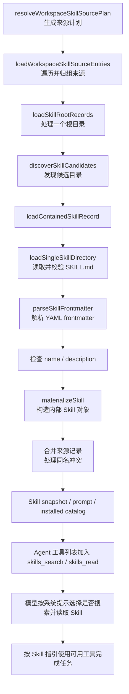
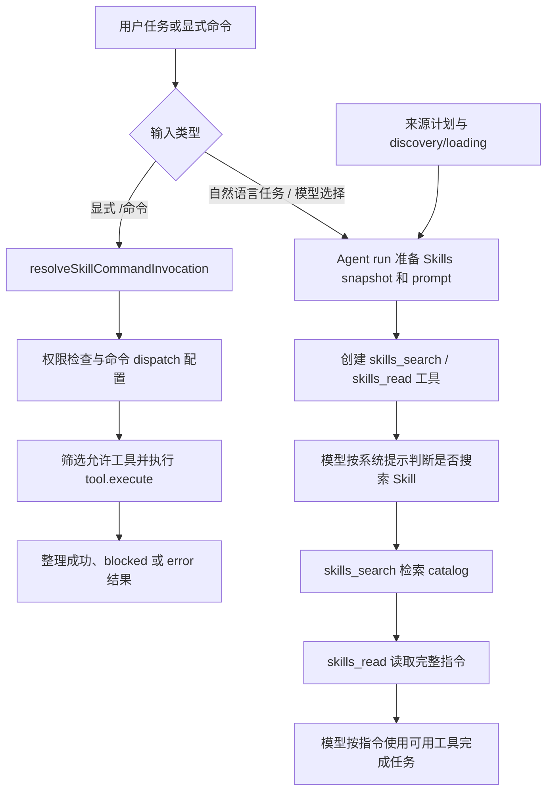

# OpenClaw Skill 生命周期源码地图（C1）

> - **版本**：v1.0（第一周源码地图）
> - **分析对象**：OpenClaw 官方仓库，commit `520302d8ee6`
> - **目标**：梳理 `SKILL.md` 元数据解析与加载优先级、Skill 的发现—加载—供 Agent 使用的主要链路，以及显式命令/工具分发路径。
> - **范围说明**：本文件是源码地图，不是逐行代码审计。结论以该 commit 的实现片段和相应测试为依据；对尚未完整追踪的模型调用循环及边界情形，明确标为待后续验证。

## 1. 核心概念

- **OpenClaw**：承载 Agent 运行、会话、工具与 Skill 管理的开源助手框架；不是一个 Skill。
- **Skill**：可复用的任务指引及相关元数据。常见形式是一个目录，里面包含 `SKILL.md`。
- **Frontmatter**：`SKILL.md` 开头两条 `---` 之间的 YAML 元数据区域，例如 `name`、`description`、`metadata.openclaw` 等。
- **Tool（工具）**：Agent 可以调用的操作接口。Skill 中的指引可以要求使用工具，但 Skill 本身不等于工具。
- **Discovery（发现）与 Loading（加载）**：发现是找出候选 Skill 目录；加载是读取并验证候选目录里的 `SKILL.md`，生成内部记录。
- **Source 与 Tier**：`source` 标识具体来源；`tier` 是加载器归组时使用的层级。多个具体来源可能属于同一 tier。

## 2. 总体调用链



该图概括主要路径；真实实现还包含缓存、诊断、安全检查、审计模式、远端/沙箱读取和不同来源分支。

## 3. 来源计划、目录发现与加载

### 3.1 来源计划：先决定“去哪里找”

- 文件：[`src/skills/loading/workspace-skill-sources.ts`](https://github.com/openclaw/openclaw/blob/520302d8ee6/src/skills/loading/workspace-skill-sources.ts)
- 入口：`resolveWorkspaceSkillSourcePlan`
- 职责：根据 workspace 路径、配置和选项整理 `roots`，并为目录记录 `dir`、`source`、`tier` 等字段；也返回插件、bundled、managed、用户目录及允许的符号链接目标等信息。
- `workspaceOnly` 为真时，会跳过该函数前面添加的非 Workspace 来源，并只加入 Workspace 根目录。
- Workspace 根目录由 [`workspace-skill-roots.ts`](https://github.com/openclaw/openclaw/blob/520302d8ee6/src/skills/loading/workspace-skill-roots.ts) 的 `resolveWorkspaceSkillDirectories` 生成：普通模式先列出项目级 `.agents/skills`（source=`agents-skills-project`），再列出 workspace 的 `skills`（source=`openclaw-workspace`）；两者在 `workspace-skill-sources.ts` 中都归入 `tier: "workspace"`。

### 3.2 发现候选 Skill：决定“哪些目录值得加载”

- 文件：[`src/skills/loading/skill-root-discovery.ts`](https://github.com/openclaw/openclaw/blob/520302d8ee6/src/skills/loading/skill-root-discovery.ts#L395)
- 入口：`discoverSkillCandidates`
- 主要职责：解析根目录实际路径；按 source 应用路径包含约束；判断根目录自身是否就是 Skill；扫描子目录和嵌套分组目录；检查是否存在候选 `SKILL.md`；对扫描候选数量、递归深度和超限情况进行控制。
- 普通发现结果包含 `candidates` 和 `rootIsSkill`，有些情况还带有 `configuredRootCandidate`。
- 发现成功只是得到候选项，不代表该 Skill 已经通过元数据检查并加载成功。

### 3.3 根目录加载：组织一批候选项

- 文件：[`src/skills/loading/skill-root-loader.ts`](https://github.com/openclaw/openclaw/blob/520302d8ee6/src/skills/loading/skill-root-loader.ts)
- `loadSkillRootRecords` 调用 `discoverSkillCandidates`，再通过内部的 `loadCandidate` 把候选项交给 `loadContainedSkillRecord`。
- `loadContainedSkillRecord` 调用 `loadSingleSkillDirectory`，成功后保留 `skill` 与 `frontmatter`，并在需要时规范化目录路径。
- `loadWorkspaceSkillSourceEntries` 遍历来源计划中的根目录，按 `tier` 归组记录，最后按规定的 tier 顺序展开为数组。

### 3.4 单个 Skill 加载：读取、解析、校验、构造

- 文件：[`src/skills/loading/local-loader.ts`](https://github.com/openclaw/openclaw/blob/520302d8ee6/src/skills/loading/local-loader.ts#L80)
- 入口：`loadSingleSkillDirectory`
- 主要步骤：
  1. 将 Skill 目录与 `SKILL.md` 拼成文件路径；
  2. 调用 `readSkillFileSync` 安全读取文本；读取失败返回 `null`；
  3. 以原始文本 `raw` 检查缓存，必要时调用 `parseSkillFrontmatter(raw)`；
  4. 解析错误时报告诊断并返回 `null`；
  5. 取元数据中的 `name`，若缺失则尝试用目录名作为 fallback；获取 `description`；没有有效名称或描述时拒绝加载；
  6. 调用 `materializeSkill` 构造内部 Skill 对象；
  7. 在满足缓存上限时保存可复用结果；最终返回 `skill`、`frontmatter` 和原始 `content`。

### 3.5 Frontmatter 解析

- 文件：[`src/skills/loading/frontmatter.ts`](https://github.com/openclaw/openclaw/blob/520302d8ee6/src/skills/loading/frontmatter.ts#L27)
- `parseSkillFrontmatter(content)` 调用 `parseFrontmatterBlockResult(content)`。若解析器返回的问题列表中有问题，则抛出错误；否则返回 `structuredClone(parsed.frontmatter)`。
- `resolveSkillManifestMetadata(frontmatter)` 会进一步整理 OpenClaw 扩展配置；`resolveSkillInvocationPolicy(frontmatter)` 会读取 `user-invocable`、`disable-model-invocation` 等调用策略字段。
- 对应测试：[`frontmatter.test.ts`](https://github.com/openclaw/openclaw/blob/520302d8ee6/src/skills/loading/frontmatter.test.ts)，包含 YAML 错误与 Link 风格元数据等案例。

## 4. 来源优先级与同名冲突

### 4.1 来源计划和 tier 顺序

`resolveWorkspaceSkillSourcePlan` 创建多个来源根目录。`loadWorkspaceSkillSourceEntries` 最终按以下顺序展开各 tier：

```text
extra → bundled → workshop → managed → personal → workspace
（从先处理到后处理）
```

`bundled` 层的记录还会按 Skill 名称、再按 `skill.source` 排序，以确定同层记录的处理顺序。Workspace tier 内，项目级 `.agents/skills` 根目录在 `skills` 根目录之前加入计划；由于同名合并采用后写覆盖，后者在该合并路径中胜出。

### 4.2 两种合并函数不要混淆

- 文件：[`src/skills/loading/skill-precedence.ts`](https://github.com/openclaw/openclaw/blob/520302d8ee6/src/skills/loading/skill-precedence.ts)
- `mergeSkillRecords(records, ...)`：使用 `record.skill.name` 作为 Map 键。再次写入同名键时，后处理的 record 会覆盖此前的 record；若文件规范化路径不同，则记录冲突信息。
- `appendLowerPrecedenceSkillRecords(entries, lower, onCollision)`：将 lower 作为低优先级输入。若名称已存在，则只调用冲突回调、不替换已有记录；若名称不存在，则追加到结果。
- `workspace-skill-loader.ts` 先合并 agent tier，再把 execution tier 作为 lower-precedence 记录追加；因此，在对应路径里，execution 的同名记录不会覆盖已有 agent tier 记录。
- Skill Library 记录在该函数后续被追加；本文没有把它的所有潜在同名交互推断为与前述层级完全相同的规则。

### 4.3 测试验证的冲突案例

测试文件：[`workspace-precedence.test.ts`](https://github.com/openclaw/openclaw/blob/520302d8ee6/src/skills/loading/workspace-precedence.test.ts#L150)

| 同名来源组合 | 测试期望胜出者 |
|---|---|
| bundled、managed、workspace | workspace |
| workshop、managed | managed |
| bundled、workshop | workshop |
| extra、bundled | bundled |
| execution、bundled | bundled |
| execution、workspace | workspace |
| extra0、extra1、extra2 | extra2 |

这些测试与实现共同说明：来源排列顺序和合并函数共同影响同名 Skill 的最终保留结果。团队任务单中的简写“workspace > project > personal > bundled”与当前实现的 tier 命名并非一一对应：当前代码把项目级 `.agents/skills` 和 workspace `skills` 都放在 workspace tier 中，并通过根目录排列顺序区分二者；实现里还存在 extra、workshop、managed 等来源。最终报告应保留源码中的实际术语，避免将它简化成只有四层。

## 5. Agent 如何获得并使用 Skill

### 5.1 为一次 Agent run 准备 Skill prompt 和 catalog

- 文件：[`src/agents/embedded-agent-runner/skill-runtime.ts`](https://github.com/openclaw/openclaw/blob/520302d8ee6/src/agents/embedded-agent-runner/skill-runtime.ts)
- 入口：`prepareEmbeddedSkills`
- 主要调用：`prepareRuntimeSkillEntries` → `buildSkillSnapshot`（若没有可复用 snapshot）→ `resolveSkillsPrompt` → `prepareInstalledSkillCatalog`。
- 返回结果中包含 `skillsPrompt`、`skillsSnapshotForRun`、`codeModeSkills`、`installedSkills` 等。若运行阶段不允许读取 Skill 或处于特定 finalization 情况，会返回空的 Skill 准备结果。
- [`installed-skill-runtime.ts`](https://github.com/openclaw/openclaw/blob/520302d8ee6/src/agents/installed-skill-runtime.ts) 的 `prepareInstalledSkillCatalog` 从 snapshot 的候选/已解析 Skill 中筛选可供模型使用的条目，并绑定读取能力、路径和当前运行的有效性检查。

### 5.2 将搜索/读取功能注册为 Agent 工具

- 文件：[`src/agents/tools/installed-skill-tools.ts`](https://github.com/openclaw/openclaw/blob/520302d8ee6/src/agents/tools/installed-skill-tools.ts)
- `createInstalledSkillTools(skills)` 创建两项工具：
  - `skills_search` → `searchInstalledSkills`：在已准备、符合条件的 Skill catalog 中搜索，主要返回名称、描述和位置等元数据；不负责安装 Skill。
  - `skills_read` → `readInstalledSkill`：按精确名称读取完整 `SKILL.md` 指令；读取指令本身不等于执行 Skill，也不授予额外工具权限。
- 文件：[`src/agents/openclaw-tools.ts`](https://github.com/openclaw/openclaw/blob/520302d8ee6/src/agents/openclaw-tools.ts)：工具组装时包含 `...createInstalledSkillTools(options?.installedSkills ?? [])`，将这些能力加入可用 Agent 工具集合。
- 文件：[`src/agents/system-prompt-skills.ts`](https://github.com/openclaw/openclaw/blob/520302d8ee6/src/agents/system-prompt-skills.ts)：根据可用工具构建 Skills 系统提示指引。指引要求在涉及文件、专用工具或可复用 workflow 等任务时，搜索适用 Skill，并在执行任务操作前读取完整指令；简单对话/可独立回答的问题不必强制搜索。

### 5.3 意图相关路径：显式命令与模型使用 Skill 工具是两条路径

**显式命令路径**

- 文件：[`chat-command-invocation.ts`](https://github.com/openclaw/openclaw/blob/520302d8ee6/src/skills/discovery/chat-command-invocation.ts)
- `resolveSkillCommandInvocation` 识别以 `/` 开头的命令形式并提取参数，支持直接命令匹配，也支持 `/skill <name> <args>` 形式。
- `get-reply-inline-actions.ts` 匹配命令后会检查发送者权限；若 `dispatch.kind === "tool"`，则调用 `resolveSkillDispatchTools` 得到当前策略下可用的工具，按 `dispatch.toolName` 找到工具，再执行 `tool.execute(...)`。结果可能是正常文本、blocked 原因或错误提示。
- 如果命令带 `promptTemplate`，程序会展开模板并更新后续 Agent body；显式 `$skill-name` 引用则由 `expandExplicitSkillReferences` 相关逻辑处理。

**模型辅助选择路径**

- Agent 的 Skills 系统提示提供 `skills_search` / `skills_read` 的使用指引；模型可根据用户任务目标调用搜索工具，选中相关 Skill 后读取完整指令，再依据指令使用当前允许的实际工具完成任务。
- `searchInstalledSkills` 是词汇检索/评分逻辑，不是独立的 LLM 意图分类器；最终是否调用搜索工具，由可用工具与系统提示指引参与模型决策。
- 当前已定位到上述命令分发、Skill catalog 工具注册和系统提示，但没有把整个模型工具调用循环逐函数追完。因此，本地图谱不宣称已经定位到一个独立、统一的 `SkillRouter` 类；在已检查路径中，路由行为分散在命令解析、系统提示、catalog 工具和 Agent 工具运行流程中。

## 6. Skill 生命周期汇总图



说明：图中 `L` 表示按已读指令继续执行实际任务，不表示每个 Skill 都必然调用工具；具体执行由 Skill 指令、模型决定、工具可用性和权限策略共同影响。

## 7. 证据与后续工作

### 已确认

- Frontmatter 解析入口、错误处理及相关配置解析函数。
- 来源计划、候选发现、单个 Skill 加载与内部对象构建的主要链路。
- tier 排列和两种合并函数的差异，以及多组同名冲突测试结果。
- 显式 Skill 命令解析、工具分发、执行结果处理的主要路径。
- Agent 运行时准备 Skill snapshot/catalog、注册 `skills_search` / `skills_read` 工具，并通过系统提示指导模型使用它们的路径。

### 建议第二周精读

1. 继续追踪 `prepareRuntimeSkillEntries` 和模型 tool-call loop，补全模型决定调用 `skills_search` / `skills_read` 后的完整执行闭环。
2. 结合 `workspace-precedence.test.ts` 及 `resolveWorkspaceSkillDirectories`，为同一 tier 内根目录冲突补充更多测试案例。
3. 对实际准备移植的 Skill，检查 frontmatter 依赖（bins/env/config）、工具名称、平台假设与外部二进制，把本源码地图用于判断鸿蒙侧需要适配的契约。

## 8. 关键源码链接索引

以下链接均固定到本次分析的 OpenClaw commit `520302d8ee6`：

- [Frontmatter 解析](https://github.com/openclaw/openclaw/blob/520302d8ee6/src/skills/loading/frontmatter.ts)
- [单个 Skill 加载](https://github.com/openclaw/openclaw/blob/520302d8ee6/src/skills/loading/local-loader.ts)
- [候选 Skill 发现](https://github.com/openclaw/openclaw/blob/520302d8ee6/src/skills/loading/skill-root-discovery.ts)
- [根目录与来源加载](https://github.com/openclaw/openclaw/blob/520302d8ee6/src/skills/loading/skill-root-loader.ts)
- [来源计划](https://github.com/openclaw/openclaw/blob/520302d8ee6/src/skills/loading/workspace-skill-sources.ts)
- [Workspace/Project roots](https://github.com/openclaw/openclaw/blob/520302d8ee6/src/skills/loading/workspace-skill-roots.ts)
- [同名冲突处理](https://github.com/openclaw/openclaw/blob/520302d8ee6/src/skills/loading/skill-precedence.ts)
- [冲突测试](https://github.com/openclaw/openclaw/blob/520302d8ee6/src/skills/loading/workspace-precedence.test.ts)
- [命令匹配与显式引用](https://github.com/openclaw/openclaw/blob/520302d8ee6/src/skills/discovery/chat-command-invocation.ts)
- [显式命令后续分发](https://github.com/openclaw/openclaw/blob/520302d8ee6/src/auto-reply/reply/get-reply-inline-actions.ts)
- [运行时 Skill 准备](https://github.com/openclaw/openclaw/blob/520302d8ee6/src/agents/embedded-agent-runner/skill-runtime.ts)
- [Installed Skill catalog 准备](https://github.com/openclaw/openclaw/blob/520302d8ee6/src/agents/installed-skill-runtime.ts)
- [Installed Skill catalog 搜索/读取](https://github.com/openclaw/openclaw/blob/520302d8ee6/src/agents/installed-skill-catalog.ts)
- [Agent Skill 工具](https://github.com/openclaw/openclaw/blob/520302d8ee6/src/agents/tools/installed-skill-tools.ts)
- [Agent 工具组装](https://github.com/openclaw/openclaw/blob/520302d8ee6/src/agents/openclaw-tools.ts)
- [Skills 系统提示](https://github.com/openclaw/openclaw/blob/520302d8ee6/src/agents/system-prompt-skills.ts)
