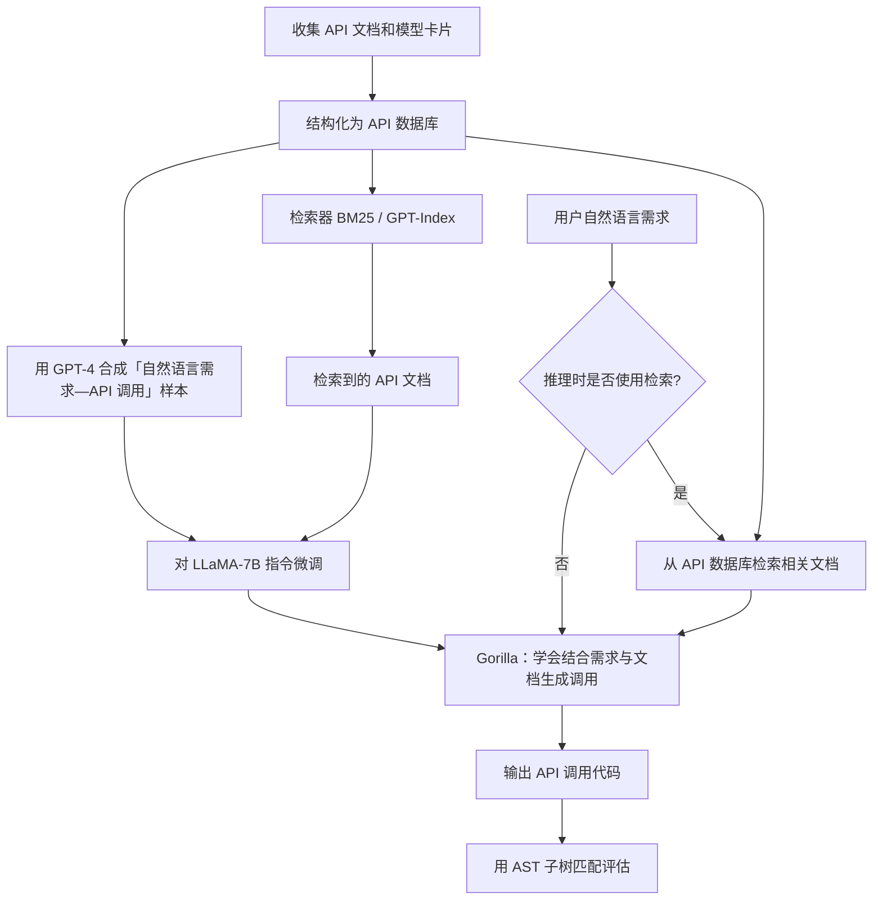

# Gorilla: Large Language Model Connected with Massive APIs — 论文解读

> 论文：Shishir G. Patil 等，NeurIPS 2024  
> 原文：[Gorilla](https://arxiv.org/abs/2305.15334)     
> 解读编写：241250088 刘馨雅

## 1. 摘要

Gorilla 要解决的问题是：当 API 数量庞大、功能相似且文档经常更新时，如何让大语言模型准确找到适用的 API、生成正确调用，并尽量避免编造不存在的 API 或参数。

## 2. 核心方法

### 机制图

> 图示说明：上半部分涉及训练，下半部分是推理和评估的概念流程。

### 机制说明

Gorilla 把**针对 API 调用的微调**与**外部文档检索**结合起来。研究者先从 HuggingFace、TorchHub 和 TensorFlow Hub 收集模型文档，筛选出共 **1,645 个 API**，整理出 API 名称、功能、参数、示例代码、性能等信息。接着利用 GPT-4 根据这些文档生成约 **16,450 组“自然语言需求—API 调用”训练样本**。模型学习到了：即使用户不说 API 名称只描述需求时，模型也知道应该选什么工具、怎样填写参数。

研究者以 LLaMA-7B 为基础进行指令微调，提出 **Retriever-Aware Training（RAT，检索感知训练）**。普通检索增强往往是“找来文档，再交给模型”；RAT 更进一步，在训练阶段就把检索到的 API 文档放进输入，让模型学习如何利用这些材料。由于检索结果可能不相关，模型不能机械照抄；它需要结合用户需求判断文档是否有用。推理时，Gorilla 可以直接回答，也可以先使用 BM25 或 GPT-Index 检索最新 API 文档，再生成调用。后者使它有机会适应 API 名称、参数或来源的更新，而不必每次都重新训练。

为了验证结果，作者构建了 **APIBench**，通过 **AST 子树匹配**判断输出的 API 及关键参数是否对应数据库中的调用，并区分“正确”“选错已有 API”和“编造不存在的 API”。

## 3. 实验结果

- 在论文采用的三个机器学习 API 集合及当时的模型版本上，Gorilla 在多项 API 调用准确率实验中优于 GPT-4、Claude 和未微调的 LLaMA。
- 不加检索时，Gorilla 在 TorchHub、HuggingFace、TensorFlow Hub 上的准确率分别为 **59.13%、71.68%、83.79%**（原文表 1）。
- 加入检索并不总能提高准确率：检索质量差时可能误导模型。
- 作者抽样人工检查了 100 组生成结果：**AST 判断正确率 78%，人工判断 API 正确率 78%，实际代码可执行率 72%**（原文表 3）。
- **结果边界**：这些比较基于论文当年的模型版本、API 数据和评价规则，不代表 Gorilla 全面优于当前通用模型，也不代表能自主完成复杂多步骤 Agent 工作流。

## 4. 与skill移植的关系

### 可以借鉴

1. **把 Skill 当作有结构的 API 文档管理：** 为每个 Skill 明确名称、功能、输入参数、返回结构、使用前提和示例，供 Agent 检索与调用。
2. **考虑动态 Skill 发现：** Skill 增多后，不必每次把全部描述放入上下文，可以先根据用户意图筛选候选 Skill，再交给模型决定具体调用。
3. **关注版本变化：** 当 Skill 参数或描述更新时，检索当前版本的说明可减少依赖模型旧记忆的问题。
4. **建立工具调用评价集：** 用自然语言任务作为输入，检查 Skill 选择是否正确、参数是否符合 schema、调用是否成功，并明确区分这几个指标。

### 不适用或不能直接照搬

- **论文不负责完整执行链：** OpenClaw—鸿蒙侧还要处理连接、权限、设备状态、异常重试等，这不是 Gorilla 论文的重点。
- **RAT 依赖微调训练：** 第一周环境和原型阶段不必训练自己的 LLaMA；可以先尝试“结构化 Skill 描述 + 检索 + Schema 校验”，再评估是否值得训练。
- **AST 评价不等于端到端正确：** Skill 即便参数合法，也可能因为权限不足、设备离线或运行时异常而失败，需要另设执行指标。
- **实验域有差异：** Gorilla 测试的主要是机器学习模型 API，鸿蒙设备 Skill 的调用特征、风险与反馈模式并不完全相同。

## 5. 疑问清单

**问题 1：检索结果本身可能出错，Agent 如何判断应该相信哪份 Skill 文档？**  
论文中的 RAT 让模型学习处理不相关文档，但这不能等同于可证明的判断。我们是否需要增加版本标记、权限白名单、Schema 校验等确定性机制？

**问题 2：当 Skill 数量还很少时，有必要引入检索吗？**  
直接把全部 Skill 描述提供给模型更简单；引入检索可能带来漏召回。应该用什么规模或指标决定架构升级？

**问题 3：我们究竟应该怎样定义“Skill 调用成功”？**  
是名称正确、参数合法、调用返回成功，还是用户的最终任务真正完成？这些指标如何分开统计？

**问题 4：如果 Skill 更新了参数，能否只更新文档而不改模型？**  
哪些变化可以通过检索解决，哪些变化必须调整提示词、适配代码或重新训练？
