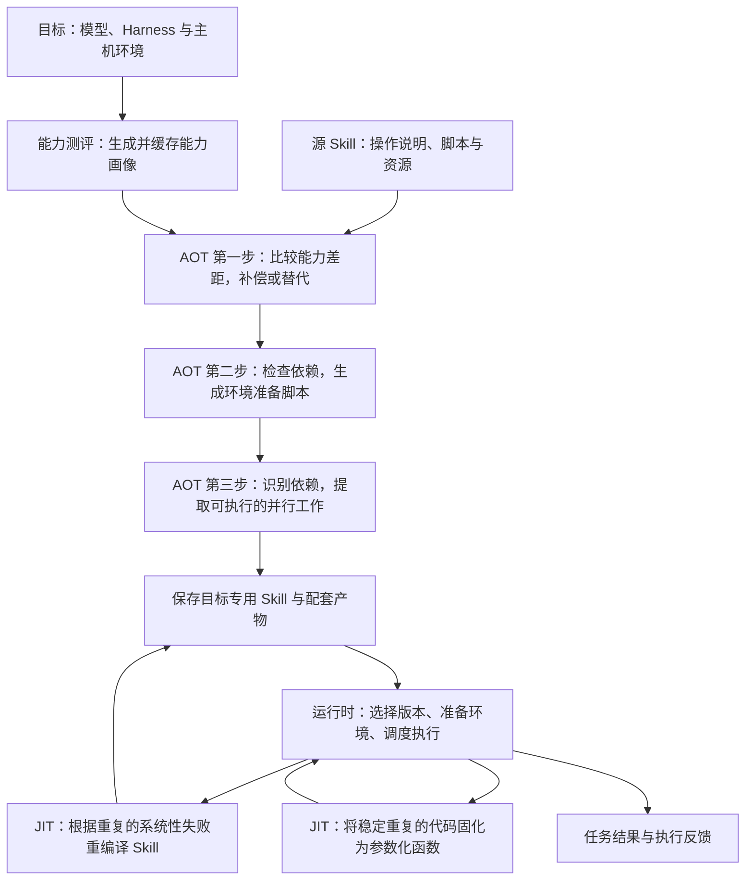

# Skill VM 论文精读笔记

## 1. 一句话摘要

针对同一份 Skill 在不同模型、执行框架和运行环境中表现不一致的问题，SkillVM 根据目标能力生成适配版本，并利用执行反馈优化后续任务的完成效果与执行效率。

## 2. 核心方法：机制图与约 500 字说明

下图依据论文 Figure 5 整理；Harness 指连接模型与工具、管理智能体执行过程的框架。

SkillVM 把 Skill 看作需要针对执行目标进行适配的程序。Skill 包含操作说明、流程和脚本，而模型能力、框架工具及主机依赖各不相同，直接加载原文可能失败。系统先用一组小测试测量目标的基本能力，形成可复用的能力画像，再提取 Skill 的能力要求，与画像比较。执行前编译分为三步：首先处理能力差距，差距较小时通过补充示例、明确路径等方式降低执行难度，差距过大时尝试替代实现；其次识别软件包、命令和服务依赖，生成环境检查与准备脚本；最后分析步骤间的数据依赖，把独立工作安排为脚本、工具调用或子智能体并行执行，目标不支持时保持顺序执行。同一源 Skill 因而可以产生多个目标版本。

运行时，系统选择匹配目标的版本并收集反馈。即时优化包含两项机制：自适应重编译根据重复的系统性失败和恢复轨迹修改 Skill；代码固化观察多次生成的代码，确认结构稳定后将其变为参数化函数，后续直接执行，避免重复生成。固化代码执行异常时退回模型路径。调度器则根据资源使用和接口限流控制并发。论文在十个模型、四种框架上进行评估，展示了任务效果和效率收益，但并非每个模型与框架都交叉评测，也并非所有任务都改善。由于改写依赖大模型，仍需检查新版是否保留原任务要求，并计入测评和编译成本。

原文位置：§3–§5、§7，PDF 第 5–13 页。

## 3. 与我们课题的关系

本文直接对应项目的 **Skill VM 路线**，也能为逐个 Skill 手工移植提供方法。以下是结合 OpenClaw 到鸿蒙项目的应用分析。

**可以借鉴：**

- **先定位失配原因。** 将迁移失败区分为模型能力、框架工具和运行环境问题，避免仅靠反复改写说明来排错。
- **建立两侧能力映射。** 记录源 Skill 的输入输出、工具、依赖与权限需求，对照鸿蒙侧可用能力，判断采用补偿还是替代实现。
- **从人工移植积累通用机制。** 把多个 Skill 中重复出现的参数转换、路径处理和依赖检查提炼为可复用的适配步骤。
- **用执行结果验证适配。** 比较无 Skill、原始版、人工适配版与自动适配版，检查功能、耗时、token 消耗和退化情况。论文提供开源代码，可作为后续复现入口；本笔记尚未进行代码复现。

**不适用或需要补充的地方：**

- 论文没有给出 OpenClaw Skill 到鸿蒙 `skillProfiles`、ArkTS 入口和权限配置的完整转换方案，需要结合 C2 组调研确定接入契约。
- 环境绑定适合处理可检查、可准备的依赖，无法保证补齐目标平台不支持的运行时或工具；遇到这类限制仍需替代方案。
- 大模型改写和替代实现可能改变任务行为，不能仅凭“能运行”认定移植正确；并行化、代码固化也需要目标执行框架提供相应支持。

## 4. 疑问清单

1. **能力测评能否预测真实任务表现？** 论文用小测试建立能力画像，但真实 Skill 可能组合多个能力并执行较长流程。如何验证画像对这些组合任务仍有预测力？
2. **自动适配怎样保持任务原意？** 将实现替换为另一种工具或鸿蒙侧能力时，如何确认输入输出、权限和副作用仍符合原要求？没有现成验证器时，应怎样设计验收标准？
3. **成本回收。** 一个低频 Skill 是否值得做测评、AOT 和多轮 JIT？需要多少次调用才能收回初始成本？依据 §7.3–§7.5。
4. **验收路径差异。** 对记录日志的改写没有重执行准入时，部署方应如何补充验证？为什么“期望不退化”不等于已证明不退化？依据附录 A。

