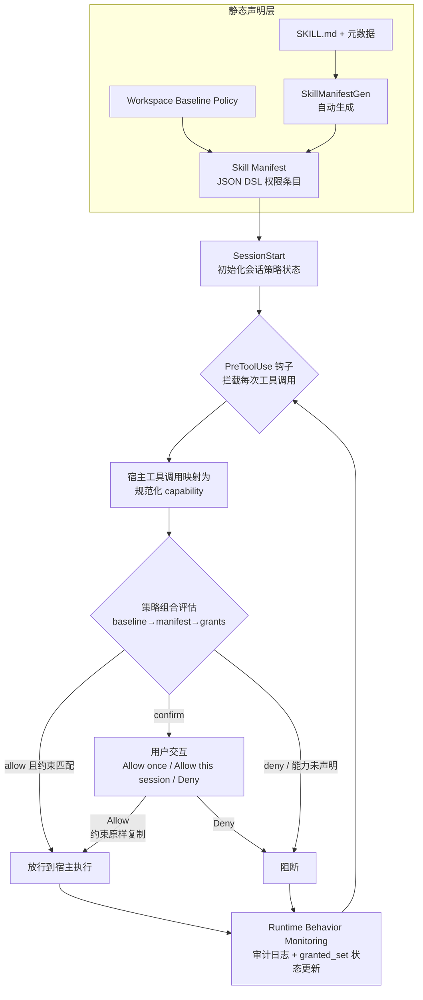

# SkillGuard: A Permission Framework for Agent Skills — 论文解读

> 论文：Shidong Pan（CSIRO）、Xiaoyun Sun 等，arXiv 2606.03024，2026-06-02  
> 原文：[SkillGuard](https://arxiv.org/abs/2606.03024)  
> 解读编写：241880555 郭德林

## 1. 摘要

这篇论文解决的问题是：Agent Skill 生态目前只做"信任式加载 + 静态检查"，没人管一个 Skill 加载后到底往 Agent 上下文里注入了什么、又能驱使 Agent 在运行时做哪些有副作用的动作——SkillGuard 把 Skill 当作**许可承载的可执行工件**（permission-bearing executable artifacts），用一套"声明式 manifest + 运行时强制"的权限框架，同时治理**上下文平面**（context plane）与**行动平面**（action plane）。

## 2. 核心方法

### 机制图

> 图示说明：对应原文 Figure 2 的工作流——上半部分是声明与初始化，中间是逐次工具调用的"映射—评估—放行/阻断"主循环，右侧用户交互对应 Android 式运行时授权。

### 机制说明

SkillGuard 的出发点是一个**双平面安全鸿沟**：Skill 既通过 context plane（注入指令、示例、检索文档、记忆片段）塑造 Agent 的推理，又通过 action plane（工具调用、文件/机密访问、网络通信、向其他 Skill/Agent/MCP 委派）产生外部可见的副作用。现有防御只看单一平面：工具层策略（如 Progent、AgentBound）挡得住危险调用，却拦不住恶意上下文引导；上下文层防御（如 A2AS）又管不住具体副作用。作者据此把 Skill 重新定义为需要权限治理的执行体，并沿用 1975 年 Saltzer & Schroeder 的经典安全原则（最小权限、完全中介、失效安全默认）加上 Android 权限模型的工程经验来设计框架。

框架由五个模块组成。**Skill Manifest** 用一个 JSON DSL 声明权限条目（capability + effect + constraints + fallback），effect 分 `allow/confirm/deny`，constraints 可表达 workspace-only、路径前缀、命令黑名单、限流等；能力名独立于具体工具名，同一宿主平台的词汇可跨 Skill 复用。声明分三层：workspace 基线策略、skill 自身 manifest、会话运行时状态文档。**Runtime Permission Access Control** 借助宿主的 `SessionStart` 与 `PreToolUse` 生命周期钩子，在每次工具调用前把宿主特定调用映射为规范能力，再对照会话策略做检查——这是完全中介的落点。**User Interaction** 把 `confirm` 类权限转成结构化授权提示，用户可选"仅本次 / 本会话内 / 拒绝"；关键细节是"本会话内允许"会把原条目连同原约束一起复制进 granted_set，方便复用但不扩大资源范围。**Policy Enforcement** 实现失效安全默认：只有当会话中存在可启用的匹配条目且约束与当前输入吻合时才放行，否则在宿主执行前阻断；对 shell 式命令这类"单命令多副作用"的场景，由一个权限生成 mini-agent 从命令推断低层能力并重新评估。**Runtime Behavior Monitoring** 为每次中介动作写审计记录（会话、钩子、工具、能力、策略来源、输入、评估结果），并把状态更新与执行耦合，保证"默认拒绝"全程可追溯。

作者还设计了 21 个 Protected Objects、8 个组（存储、代码仓库、网络、执行、硬件、系统、机密、Agent 生态）的权限分类学，每个权限标注 dangerous/normal/system/reject 四档保护级别。

## 3. 实验结果

实验以 Claude Code（MiMo-V2.5-Pro 底座）为 Agent，Claude Sonnet 4.6 做 judge，Docker 容器隔离，围绕五个 RQ：

- **RQ1 分类学表达力**：从 SkillMP 真实市场按 63 类各取 5、共 315 个 Skill，双人标注（Cohen's Kappa 0.656）。219 个（69.5%）有明确资源目标，共观测 234 个对象，预定义分类覆盖 **99.76%**、组级覆盖 **100%**；`SOURCE_CODE` 最常见（31.1%），17.6% 的权限请求属 dangerous 级。
- **RQ2 Manifest 完备性**：23 个干净 Skill 的人工参照 manifest 对照下，自动生成达到能力级 **P 85.6% / R 97.1% / F1 91.0%**，effect 字段准确率 100%、约束准确率 98.8%；但 manifest 层面 56.5% 存在过度声明、17.4% 存在欠声明。
- **RQ3 防御效果**：SkillInject 基准上，上下文型注入的攻击成功率（ASR）从 **32.37% 降到 23.02%**（-9.35pp），明显型注入从 **25.56% 降到 16.67%**（-8.89pp）。成功拦截案例：Skill 脚本把文档内容经未声明的 `web.post` 外传；绕过案例：不需要新能力的攻击（如诱导 Agent 伪造 git 提交历史——push 本身是 manifest 允许的合法动作）。
- **RQ4 效用保持**：配对任务上任务成功率仅从 86.96% 降到 **85.51%**（-1.45pp）；假阳性根源是 manifest 生成器只读 SKILL.md、不分析被调用脚本，导致脚本运行所需能力漏声明。
- **RQ5 效率**：token 开销中位数 **+20.9%**（267k vs 221k）、均值 +32.0%，主要来自权限验证模块（中位 43k/次）与额外推理轮次；墙钟时间反而**更快**（中位 -20.9%：438s vs 493s），因为恶意动作被阻断后 Agent 提前终止，不再空转。

**结果边界**：只评估了单一 Agent 脚手架（Claude Code）与单一底座模型；权限生成依赖 LLM 静态阅读而非代码分析；跨模型、跨脚手架的泛化是作者自认的效度威胁。

## 4. 与skill移植的关系

### 可以借鉴

1. **frontmatter 门控 → 权限 manifest 的升级路径**：OpenClaw 的 `requires.bins/env/config` 与 `os` 字段只是"依赖存在性检查"，SkillGuard 的 capability + effect + constraints 是"行为性契约"。为移植到鸿蒙的 Skill 生成权限 manifest，可以直接对接鸿蒙自身的 ACL / 应用权限体系，补上 research-goals 里"鸿蒙侧缺少成熟沙箱/权限对接"的短板。
2. **工具调用 → 规范能力映射正是方向 B 的宿主适配层**：SkillGuard 把"宿主特定工具名"与"平台无关能力词汇"解耦，同一份 manifest 跨 Skill 复用——这与 Skill VM 想做的"Skill 与具体 OS 解耦、一次编写多端运行"是同构思路，权限声明可并入我们的 IR 设计。
3. **deny-by-default + 完全中介的执行管线**：可作为鸿蒙侧 Skill 沙箱的设计基线；hook 式架构（不改 Agent 内核、只重生成 tool-to-capability 映射即可适配新运行时）对"OpenClaw 宿主 / 鸿蒙宿主双目标"尤其有吸引力。
4. **21 类 Protected Objects 分类学**：可直接作为我们 Skill 清单分类与评测的维度之一（哪些被移植 Skill 触碰了 dangerous 级对象，优先做沙箱验证）。
5. **"阻断反而更快"的反直觉结果**：提示我们在评测移植后的 Skill 时，把安全机制的墙钟开销与 token 开销分开统计，避免误判。

### 不适用或不能直接照搬

- **拦截点依赖宿主钩子**：PreToolUse/SessionStart 是 Claude Code 的生命周期钩子；鸿蒙侧大模型运行时（盘古等）是否有等价的工具调用拦截点未知，完全中介可能要在 Ability 调用层或推理框架层重新实现。
- **manifest 生成不做代码分析**：RQ4 的假阳性已暴露这一局限；我们的 Skill 普遍携带外部二进制依赖（`bins`），权限推断比纯 Markdown Skill 更难，需要补充静态/动态分析。
- **治理的是权限，不是可移植性**：SkillGuard 不回答"Skill 在鸿蒙上能不能跑"（依赖缺失、API 不同、shell 不存在），与方向 A 的工作是互补关系，不能替代移植本身。
- **端侧开销需裁剪**：中位 +20.9% 的 token 开销对云端 Agent 可接受，但鸿蒙端侧/资源受限场景可能偏贵，可考虑只对 dangerous 级能力走完整管线。

## 5. 疑问清单

**问题 1：鸿蒙侧没有 PreToolUse 这类拦截钩子时，"完全中介"的检查点应该放在哪一层？**
是放在 ArkTS Ability 调用层、推理框架的 function-calling 出口，还是包一层 Skill VM 的执行器？如果找不到统一拦截点，SkillGuard 的安全保证会打多少折扣？

**问题 2：OpenClaw 的 `requires.bins/env/config` 门控能否无损翻译成 capability + constraints 条目？**
`os` 字段的取值域是 `darwin|linux|win32`，鸿蒙语境下应扩展为 `harmonyos` 还是映射到最近的等价类？这个映射规则应该由谁（Skill 作者、移植工具、还是权限生成 mini-agent）决定？

**问题 3：对端侧设备，权限分类学需要扩充哪些鸿蒙特有对象？**
21 类 Protected Objects 面向开发者桌面/云环境；鸿蒙特有的分布式软总线、跨设备迁移、传感器等对象是否需要新增分类与保护级别？

**问题 4：56.5% 的过度声明率在真实生态里意味着什么？**
过度声明会放大攻击面（与least privilege相悖）、欠声明触发确认打断用户——我们的移植档案里是否也该把"权限声明的过/欠声明"作为移植质量的量化指标？
