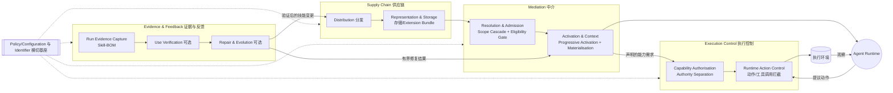

# 论文精读：Harnessing Agent Skills

> 基于 arXiv HTML 原文通读后撰写。引用章节号对应原文（§）。

## 1. 一句话摘要

Skill 文件本身是静态的，真正的风险与责任出现在它“被选中、绑定权限、被 LLM 解释执行、留下证据”的运行期（作者称 **skill-in-use**）；论文通过对 37 个系统 + 51 篇论文的多声部文献综述（MLR），归纳出 **10 个架构模式** 和一个 **四层参考架构**，用来系统分析“Skill 如何被安全地接入并受控执行”。

## 2. 核心方法

### 2.1 三个核心概念（§2.1）

| 概念 | 含义 |
| --- | --- |
| Skill artefact | 静态存放的技能文件（如 `SKILL.md`），带身份、版本、来源、作用域 |
| Skill-in-use | 某次运行中，某个技能版本被选中并绑定了上下文、策略与权限后的“运行时参与” |
| Skill-mediated behaviour | 受其影响的可观察行为（工具调用、输出、环境动作等） |

关键洞察：同一个 artefact 在不同运行中可有不同 skill-in-use；同一个 skill-in-use 因 LLM 随机解释，也可能产生不同行为。因此“技能被激活”不等于“技能被按预期执行”（enactment gap）。

### 2.2 五个架构关切 → 五个核心模式（§2.3、§4）

1. **选择性运行参与 → Progressive Skill Activation**：技能分 available / selectable / active 三态，先只暴露描述符，激活后才加载正文，降低上下文开销并让“真正有影响的技能集合”可见。
2. **引用能力不等于授予权限 → Skill–Execution Authority Separation（与本课题最相关）**：Skill 里写了“要用某工具”只是**建议**，是否允许调用由独立的授权策略（agent/工作区/平台/用户层）决定；不匹配时阻断、升级审批或报告，而不是隐式扩权。变体：skill 级预批准（如 Claude Code / Copilot 的 `allowed-tools`）、agent/profile 级绑定、平台级绑定（如 Codex 的 `agents/openai.yaml`）、验证条件绑定（研究性）。
3. **解释而非执行 → Verifiable Skill Contract**：给技能附带可独立检查的契约（接口约束、断言、重放测试），由独立 verifier 产出 passed / failed / inconclusive 状态。目前偏研究性。
4. **运行期溯源 → Runtime Skill-BOM**：每次运行生成以技能为中心的清单，记录哪些技能、什么版本、被暴露/选中/激活/排除，类比软件物料清单（SBOM）。
5. **运行到产物反馈 → Skill–Agent Co-Evolution Loop**：运行证据驱动技能修订，但必须经验证、版本化后回流，不能直接改共享技能。

另有 5 个支撑模式：Skill Eligibility Gate（准入门：校验/信任/适用性满足才进入可选池）、Skill Scope Cascade（多作用域优先级解析）、Skill Resource Materialisation Boundary（激活与加载附带脚本/文件分离）、Skill Extension Bundle（技能与其依赖作为一个部署边界）、Runtime Skill Repair（同次运行内的有界修复）。

### 2.3 参考架构（§5，图 8）

要点：
- 四层 + 两个横切基座（策略/配置、标识符）。各块之间是偏序依赖而非固定流水线。
- **安全相关的两道闸**：Mediation 层的“准入门”（谁能进入候选池）与 Execution Control 层的“能力授权 + 动作拦截”（激活后能做什么）。激活技能不等于授权其引用的能力。
- 评估（§6）：把 Claude Code、Codex、Copilot、Hermes、Aeon、OpenClaw、Microsoft Agent Framework、Snowflake Cortex 八个系统映射到各责任块。结果：存储与激活实现最充分；资源准入多为部分实现；**证据、验证、修复/演化最薄弱**，使用验证几乎无直接实现。作者明确这是“一致性/诊断性”评估，并非独立验证，也不衡量系统质量。

## 3. 与我们课题的关系

### 3.1 可以借鉴

1. **“能力引用 ≠ 权限授予”直接对应我们的门控设计。** OpenClaw 的 `requires.bins/env/config` 与 `os` 属于**加载期过滤**（对应 Eligibility Gate），论文评估中 OpenClaw 的 Resolution & Admission 为直接实现，但 Capability Authorisation 与 Runtime Action Control 在公开证据中未体现（表 4 为 N）。移植到鸿蒙时可补上这一层：Skill 只声明所需能力，鸿蒙侧通过独立的授权策略（对应 `skillProfiles` 中的 `permissions` 字段语义，需 C2 组确认）决定是否放行。
2. **Skill VM（方向 B）可直接采用该参考架构作为分层蓝本**：IR 里保留“能力需求声明”，VM 的宿主适配层承担 Capability Authorisation + Runtime Action Control，把鸿蒙权限体系作为授权策略来源，从而缓解研究目标中的“安全与沙箱”难点（RQ2）。
3. **Skill-BOM 可用于移植验证**：方向 A 的“移植档案”可扩展记录每次运行的技能版本、激活决策、授权结果，便于对比移植前后行为（支撑 RQ1、RQ3）。
4. **Progressive Activation 与 Resource Materialisation Boundary**：鸿蒙端资源受限，描述符优先、正文按需加载、脚本加载单独授权，既省上下文也减少攻击面。
5. **Scope Cascade**：OpenClaw 的“工作区 > 项目 > 个人 > 托管 > 内置”优先级属于此模式；论文指出误解析会导致行为漂移而非报错，移植时需保持并测试该优先级。
6. **§7.2 “转换链”视角**：审查应针对环节之间的接缝（作用域漂移、物化漂移、权限漂移、溯源漂移），可作为我们安全测试用例的设计思路。

### 3.2 不适用 / 局限

1. 论文是**概念性、描述性**的架构研究，不提供可运行代码、性能或安全性实验数据，不能直接落地为实现，也不证明这些模式能降低攻击成功率。
2. 数据来自 2026 年 5 月的公开文档快照，作者承认“未公开的内部控制”无法观察，“表中 N 不等于未实现”；对 OpenClaw 的判断需我们对照源码（C1 组）核实。
3. 评估存在循环验证风险（RA 与评估使用同一语料，§8.2），且无利益相关者访谈。
4. 未涉及 HarmonyOS 或国产大模型的具体权限体系、沙箱机制，也没有“跨 OS 移植”维度；Skill 的恶意内容攻击（提示注入、凭据泄露）只在相关工作中被提及，并非论文重点。
5. 参考架构是逻辑责任视图，不规定组件边界，如何映射到 ArkTS/Native 运行时需要我们自行设计。

## 4. 疑问清单（分享会讨论）

1. **权限落在哪一层？** 鸿蒙的 `skillProfiles.permissions` 与系统级权限申请，应当对应论文的 Capability Authorisation（Skill 级）还是 Runtime Action Control（平台级）？两者冲突时以谁为准？
2. **OpenClaw 的 `requires`/`os` 门控算不算“授权”？** 论文将其视为准入过滤而非授权（我的理解）；若 Skill 正文里指示模型执行 shell 命令，OpenClaw 实际由谁拦截？需要 C1 组从源码确认。
3. **Skill-BOM 在端侧的成本。** 在鸿蒙设备上为每次运行记录技能版本、激活和授权证据，存储与隐私开销是否可接受？标识符（run/skill/version）该由谁生成？
4. **验证非确定性行为。** Verifiable Skill Contract 如何对 LLM“可能忽略指令”的情况给出可靠判定？论文自己也把它标为研究性成熟度，我们的 Skill VM 是否需要引入最小契约（例如 IR 级的前后置条件）？
5. **“Skill 同时包含脚本与指引”如何拆分？** 按 Skill Extension Bundle 与 Authority Separation，脚本类依赖（`bins`）在鸿蒙上不存在时，应当作“不可移植”还是“经适配层重写后再授权”？
6. （读不懂/待确认）论文中 Runtime Skill Repair 的“有界”边界（修复预算、局部性）具体如何度量，原文只给方向性描述，是否值得纳入我们的原型？

## 5. 其它信息

- 开源代码：论文未给出自带代码仓库；其依据的系统文档链接见原文正文（Claude Code、Codex、OpenClaw 文档等），可用于方向 A 的对比参考。
- 复现性：数据为公开文档快照，作者建议将其视为证据基线；复现需重新检索，并且结果不会完全一致（§8.4）。
- 建议后续阅读：同主题伙伴论文（安全/门控实证研究），以及论文参考文献中的 *Progent: Programmable Privilege Control for LLM Agents*（arXiv:2504.11703）、*Malicious Agent Skills in the Wild*（arXiv:2602.06547）、*Skill-Inject*（arXiv:2602.20156）。
